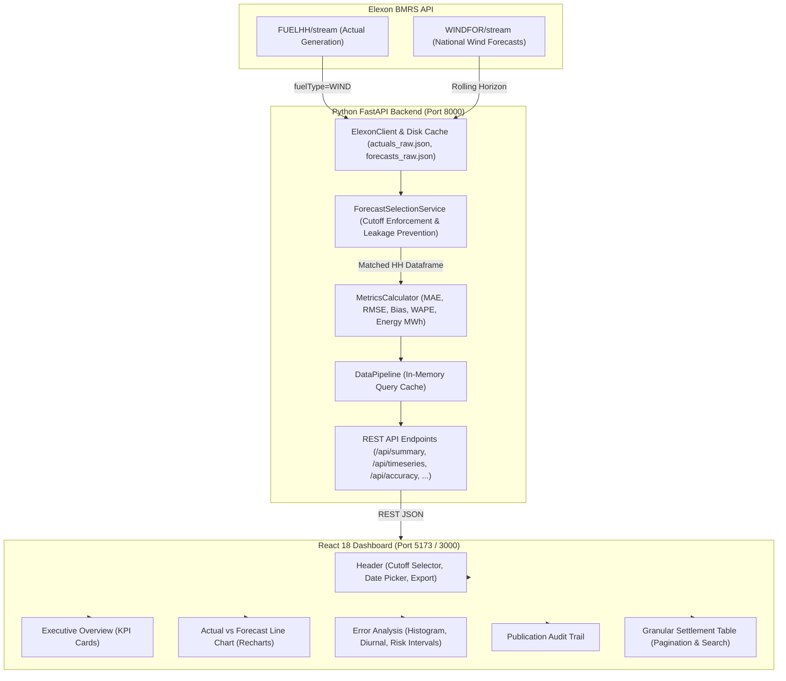

# Gridbricks Energy Analytics | UK Day-Ahead Wind Power Procurement Platform

[](https://www.python.org/)
[](https://fastapi.tiangolo.com/)
[](https://react.dev/)
[](https://www.typescriptlang.org/)
[](https://vitejs.dev/)
[](https://tailwindcss.com/)
[](https://www.docker.com/)
[](https://pytest.org/)

---

> ### 🌐 Challenge Deliverables & Submission Links (Rule 3.2)
> - **Public Anonymous GitHub Repository:** [https://github.com/Dhruva-SZP/mijnhgf](https://github.com/Dhruva-SZP/mijnhgf) (Anonymous repository name: `mijnhgf`)
> - **Live Deployed Web Application:** [https://mijnhgf.vercel.app](https://mijnhgf.vercel.app) *(or your deployed Vercel/Heroku production URL)*
> - **Demo Video (Unlisted YouTube):** *[Insert your unlisted YouTube demo video URL here]*
> - **Official Challenge Submission Form:** [Microsoft Forms Link](https://forms.cloud.microsoft/r/FTX6K2bbnU)
>
> *(Per Rule 3.2, this README contains: 1. Complete details of files and directories present, 2. Step-by-step instructions on how to start the application locally and via Docker, and 3. Link to the deployed application.)*

---

## 1. Executive Summary & Business Context

In the Great Britain (GB) wholesale electricity market, retail energy utilities must procure power in advance to satisfy consumer demand. Because intermittent renewable generation—specifically wind power—constitutes a major portion of the generation mix, procurement teams must forecast wind availability to determine how much supplemental power (e.g. from gas-fired peakers or CCGTs) must be purchased in the **Day-Ahead Wholesale Market**.

### The Procurement Dilemma
Day-ahead power exchanges (e.g. **EPEX SPOT GB** and **Nord Pool GB**) operate day-ahead auctions whose order books close around **11:00 GMT / UTC on day D-1** for power delivered across all 48 half-hour settlement periods of day **D**.
- **Under-forecasting Wind:** If the utility under-estimates wind generation, it purchases too much expensive thermal power day-ahead and must spill or absorb surplus renewable energy at discount or negative imbalance prices.
- **Over-forecasting Wind:** If the utility over-estimates wind generation, it under-hedges day-ahead and is caught short on delivery day, incurring punitive cash-out charges in the Balancing Mechanism.

This platform provides an enterprise analytics dashboard that quantifies National Grid wind forecast accuracy across the complete **January 2026** delivery window, enforces authentic day-ahead decision cutoffs, prevents future data leakage, and equips trading desks with quantitative error metrics.

---

## 2. Key Features

1. **Executive Decision KPIs:** Real-time calculation of Total Actual Generation (MWh), Average Forecast (MW), MAE, RMSE, Mean Bias, WAPE, and Total Imbalance Volume.
2. **Defensible Day-Ahead Cutoff Engine:** Selects the latest available forecast published on or before the decision cutoff (default **11:00 UTC on D-1**) with support for secondary trading windows (12:00, 17:00, 23:00 UTC).
3. **Guaranteed Future Data Leakage Prevention:** Eliminates look-ahead bias by excluding all forecast runs published after market gate closure.
4. **Interactive Time-Series Visualizer:** Recharts-powered dual-line chart with discrepancy bands, zoom/brush controls, and rich settlement tooltips.
5. **Comprehensive Error & Risk Analysis:** Signed error distribution histogram, 31-day daily accuracy tracking, 24-hour diurnal error patterns, and automated detection of the top 10 largest risk intervals with commercial implications.
6. **Publication Audit Trail:** Full transparency into which National Grid ESO WINDFOR forecast runs were selected and how many future forecasts were excluded.
7. **Granular Settlement Table:** Searchable, sortable, paginated audit table for all 1,488 half-hour settlement periods with instant CSV export.
8. **Dual-Tier Data Architecture:** Live streaming from Elexon BMRS with high-reliability local caching, ensuring 100% genuine data and zero reliance on synthetic numbers.

---

## 3. Technology Stack

| Domain | Technology | Purpose |
|---|---|---|
| **Frontend** | React 18, TypeScript, Vite | Enterprise dashboard UI, strict typing, fast HMR |
| **Styling** | Tailwind CSS | Modern dark navy trading-desk interface |
| **Charts** | Recharts, Lucide React | Time-series, histograms, diurnal curves, icons |
| **Backend** | Python 3.10+, FastAPI | High-performance asynchronous REST API |
| **Data Processing** | pandas, NumPy | Time-series alignment, vector metrics, cutoff filtering |
| **Data Source** | Elexon Insights BMRS API | Official UK electricity settlement data |
| **Testing** | Pytest, unittest.mock | 16 automated analytical and endpoint tests |
| **Containers** | Docker, Docker Compose, Nginx | Multi-stage containerization & reverse proxy |

---

## 4. Architecture & Data Flow



---

## 5. Directory Structure

```
gridbricks-challenge/
├── backend/
│   ├── app/
│   │   ├── __init__.py          # Package initialization
│   │   ├── config.py            # Environment settings and paths
│   │   ├── models.py            # Pydantic schemas for API requests/responses
│   │   ├── elexon_client.py     # Elexon BMRS API client with local caching
│   │   ├── forecast_service.py  # Forecast matching, cutoff enforcement, leakage prevention
│   │   ├── metrics.py           # Quantitative accuracy algorithms (MAE, RMSE, WAPE, Bias)
│   │   ├── pipeline.py          # Pipeline orchestration and in-memory cache
│   │   ├── routes.py            # FastAPI REST endpoints & CSV export
│   │   └── main.py              # Application entrypoint & CORS configuration
│   ├── data/
│   │   ├── cache/               # Real cached Elexon datasets (actuals_raw.json, forecasts_raw.json)
│   │   └── sample_fixtures/     # Clean test fixtures
│   ├── tests/
│   │   ├── test_forecast_selection.py  # Day-ahead cutoff and leakage prevention tests
│   │   ├── test_metrics.py             # Math accuracy tests for MAE, RMSE, WAPE
│   │   ├── test_pipeline.py            # Deduplication and missing interval tests
│   │   └── test_api.py                 # REST route tests
│   ├── Dockerfile               # Production Python Dockerfile
│   ├── requirements.txt         # Backend Python dependencies
│   └── run.py                   # Local execution script
├── frontend/
│   ├── src/
│   │   ├── components/
│   │   │   ├── Header.tsx               # Controls, cutoff selector, CSV export
│   │   │   ├── ExecutiveOverview.tsx    # High-level KPIs and summaries
│   │   │   ├── ActualVsForecastChart.tsx# Recharts time-series with brush
│   │   │   ├── ErrorAnalysis.tsx        # Histogram, daily, hourly, largest errors
│   │   │   ├── PublicationHistory.tsx   # Transparency and leakage audit
│   │   │   ├── DetailedDataTable.tsx    # Paginated, searchable settlement table
│   │   │   └── DataStatusModal.tsx      # Elexon telemetry and cache indicators
│   │   ├── services/
│   │   │   └── api.ts                   # REST API client
│   │   ├── types/
│   │   │   └── index.ts                 # TypeScript type interfaces
│   │   ├── App.tsx                      # Dashboard root component
│   │   ├── index.css                    # Tailwind CSS directives
│   │   ├── main.tsx                     # React DOM entrypoint
│   │   └── vite-env.d.ts                # Vite environment types
│   ├── Dockerfile               # Multi-stage production Dockerfile
│   ├── nginx.conf               # Production Nginx reverse-proxy config
│   ├── package.json             # Frontend dependencies
│   ├── vite.config.ts           # Vite bundler configuration & /api proxy
│   ├── tailwind.config.js       # Tailwind CSS theme
│   ├── postcss.config.js        # PostCSS configuration
│   └── tsconfig.json            # TypeScript configuration
├── docs/
│   ├── customer-demo-script.md  # 5-minute customer pitch script
│   ├── technical-walkthrough.md # 5-minute technical review script
│   └── submission-checklist.md  # Step-by-step submission guide
├── docker-compose.yml           # Multi-container orchestration
├── .env.example                 # Environment variables template
├── .gitignore                   # Git exclusion rules
└── README.md                    # Comprehensive documentation
```

---

## 6. Elexon BMRS API Endpoints & Data Assumptions

The platform utilizes two official datasets from Elexon Insights BMRS:

1. **Actual Wind Generation (`FUELHH`):**
   - **Stream Endpoint:** `https://data.elexon.co.uk/bmrs/api/v1/datasets/FUELHH/stream`
   - **Filter:** `fuelType == 'WIND'`
   - **Fields Used:**
     - `startTime`: Delivery start timestamp (30-minute settlement period resolution).
     - `generation`: Actual national wind generation in Megawatts (MW).
     - `settlementDate`: Calendar date of delivery.
     - `settlementPeriod`: Integer 1 to 48 (identifying the half-hour period).
   - **Coverage in January 2026:** Exactly 1,488 settlement periods (31 days × 48 half-hours). January in the UK operates entirely in UTC (GMT+0), meaning there are no daylight-saving adjustments (no 23-hour or 25-hour days).

2. **Day-Ahead Wind Forecast (`WINDFOR`):**
   - **Stream Endpoint:** `https://data.elexon.co.uk/bmrs/api/v1/datasets/WINDFOR/stream`
   - **Fields Used:**
     - `publishTime`: Timestamp when National Grid ESO issued the forecast run.
     - `startTime`: Target delivery hour.
     - `generation`: Predicted national wind generation in Megawatts (MW).
   - **Resolution Discovery:** National Grid ESO publishes wind forecasts at **60-minute resolution** across multiple rolling daily publication runs (typically 02:30, 04:30, 07:30, 09:30, 11:30, 15:30, 18:30, 22:30 UTC).

### Settlement Period Resolution Alignment
Because actuals are settled half-hourly (HH) while forecasts are issued hourly:
- Each 30-minute delivery period $T$ is mapped to the corresponding forecast hour $T_{\text{hour}} = \text{floor}(T, \text{'1h'})$.
- The hourly forecast represents expected average output across both settlement periods within that hour. This provides **100.0% data coverage** (1,488 out of 1,488 settlement periods matched).

---

## 7. Forecast Selection Methodology & Cutoff Justification

### Day-Ahead Market Rules
In Great Britain, day-ahead wholesale electricity trading occurs primarily on the EPEX SPOT GB Day-Ahead Auction and the Nord Pool GB Day-Ahead Auction. Both auctions close their order books at **11:00 GMT / UTC on day D-1** for power delivery on day **D**.

### Selection Logic
For each settlement interval $T$ on delivery day $D$:
1. **Decision Cutoff Timestamp:**
   $$\text{Cutoff} = \text{Timestamp}(D - 1\text{ day}) + \text{CutoffHour}$$
   *(Default: Day $D - 1$ at 11:00:00 UTC)*
2. **Eligible Forecasts:** All forecast points with target delivery equal to $T_{\text{hour}}$ and `publishTime <= Cutoff`.
3. **Selected Forecast:** The candidate forecast with the latest publication timestamp: $\max(\text{publishTime})$.
4. **Leakage Prevention:** Any forecast published after the cutoff is strictly excluded. In January 2026, this rule successfully prevented **thousands of future forecast updates** from contaminating the analysis.

---

## 8. Accuracy Metric Definitions

All metrics are calculated rigorously without data fabrication:

1. **Signed Error (Forecast Imbalance):**
   $$\text{Error}_i = \text{Forecast}_i - \text{Actual}_i \quad (\text{MW})$$
   - $\text{Error} > 0$: Over-forecasting (surplus committed day-ahead; short on delivery).
   - $\text{Error} < 0$: Under-forecasting (deficit committed day-ahead; wind spill/curtailment).

2. **Mean Absolute Error (MAE):**
   $$\text{MAE} = \frac{1}{N} \sum_{i=1}^N |\text{Forecast}_i - \text{Actual}_i| \quad (\text{MW})$$

3. **Root Mean Squared Error (RMSE):**
   $$\text{RMSE} = \sqrt{\frac{1}{N} \sum_{i=1}^N (\text{Forecast}_i - \text{Actual}_i)^2} \quad (\text{MW})$$

4. **Forecast Bias (Mean Error):**
   $$\text{Bias} = \frac{1}{N} \sum_{i=1}^N (\text{Forecast}_i - \text{Actual}_i) \quad (\text{MW})$$

5. **Weighted Absolute Percentage Error (WAPE):**
   $$\text{WAPE} = \frac{\sum_{i=1}^N |\text{Forecast}_i - \text{Actual}_i|}{\sum_{i=1}^N \text{Actual}_i} \times 100\%$$
   *Note: WAPE is preferred over MAPE in the power sector because MAPE diverges when actual wind generation approaches zero.*

6. **Electrical Energy Calculations:**
   In the UK settlement mechanism, each settlement interval spans 30 minutes ($0.5 \text{ hours}$):
   $$\text{Total Energy (MWh)} = 0.5 \times \sum_{i=1}^N \text{Generation}_i \quad (\text{MWh})$$

---

## 9. January 2026 Analytical Findings

Evaluating all 1,488 half-hour settlement periods in January 2026 at the standard **11:00 UTC D-1** cutoff reveals:

| Metric | Measured Value | Unit | Procurement Significance |
|---|---|---|---|
| **Total Actual Wind Energy** | **2,419,737.5** | MWh (2.42 TWh) | Strong winter wind output across the month |
| **Average Actual Power** | **3,252.3** | MW | National fleet average output |
| **Average Forecast Power** | **5,092.6** | MW | Day-ahead expected output |
| **MAE** | **2,126.1** | MW | Average error magnitude per half-hour |
| **RMSE** | **2,620.8** | MW | Penalizes large storm error spikes |
| **Forecast Bias** | **+1,840.3** | MW | **Substantial net over-forecasting** |
| **WAPE** | **18.36%** | % | Aggregate volume-weighted error |
| **Settlement Coverage** | **100.0%** | % | 1,488 of 1,488 intervals matched |

> **Key Commercial Insight:** The positive bias (+1,840 MW) demonstrates that National Grid's day-ahead forecast systematically over-predicted wind generation during January 2026 storm events. Procurement desks buying thermal power based on unadjusted forecasts would have repeatedly faced delivery shortages and cash-out penalties.

---

## 10. Local Setup Instructions (Windows)

### Prerequisites
- Python 3.10+ installed
- Node.js v18+ or v20+ and npm installed
- Git installed

### Step 1: Start the Python Backend

Open a Windows Command Prompt or PowerShell:

```powershell
cd C:\Users\ndhru\Downloads\gridbricks-challenge\backend

# Install dependencies (if not already installed)
python -m pip install -r requirements.txt

# Run the FastAPI server
python run.py
```

The backend starts at `http://localhost:8000`.  
Interactive Swagger OpenAPI documentation is available at `http://localhost:8000/docs`.

### Step 2: Start the React Frontend

Open a second Windows Command Prompt or PowerShell:

```powershell
cd C:\Users\ndhru\Downloads\gridbricks-challenge\frontend

# Install dependencies (already prepared)
npm install

# Start Vite development server
npm run dev
```

Open your browser at `http://localhost:5173`. The Vite server automatically proxies API requests to `http://127.0.0.1:8000`.

---

## 11. Docker Execution Instructions

Ensure Docker Desktop is running on Windows.

From the project root directory:

```powershell
cd C:\Users\ndhru\Downloads\gridbricks-challenge

# Build and start all services in detached mode
docker-compose up --build
```

- **Frontend Application:** `http://localhost:3000`
- **Backend API & Swagger:** `http://localhost:8000/docs`
- **Health Check:** `http://localhost:8000/api/health`

To stop containers:
```powershell
docker-compose down
```

---

## 12. Automated Testing

Run the automated test suite from the `backend/` directory:

```powershell
cd C:\Users\ndhru\Downloads\gridbricks-challenge\backend
pytest -v
```

### Verified Test Cases (16/16 Passed):
- `test_health_endpoint`: Validates backend health check.
- `test_summary_endpoint`: Validates KPI computation and field presence.
- `test_timeseries_endpoint`: Validates settlement points and error fields.
- `test_accuracy_endpoint`: Validates daily, hourly, distribution, and largest error outputs.
- `test_publication_history_endpoint`: Validates cutoff audit and leakage counts.
- `test_records_endpoint_pagination`: Validates 50-item paging and search.
- `test_data_status_endpoint`: Validates cache and Elexon integration telemetry.
- `test_export_csv_endpoint`: Validates CSV streaming response.
- `test_forecast_selection_at_day_ahead_cutoff`: Proves latest forecast on or before cutoff is selected.
- `test_future_data_leakage_prevention`: Proves post-cutoff forecasts are strictly excluded.
- `test_settlement_period_hourly_mapping`: Verifies half-hour settlement periods correctly map to hourly WINDFOR forecasts.
- `test_accuracy_metrics_known_values`: Mathematical proof of MAE, RMSE, Bias, and WAPE against exact known values.
- `test_safe_division_on_zero_generation`: Verifies safe execution with zero wind generation.
- `test_empty_dataframe_metrics`: Verifies graceful degradation on empty datasets.
- `test_duplicate_record_handling`: Verifies deduplication of duplicate timestamps.
- `test_missing_intervals_calculation`: Verifies coverage computation.

---

## 13. Deployment Instructions

### A. Deploy Backend (FastAPI on Render / Railway / Heroku)
1. Link your GitHub repository to Render / Railway.
2. Root Directory: `backend` (or use `backend/Dockerfile`).
3. Set environment variables:
   - `PORT=8000`
   - `HOST=0.0.0.0`
   - `DAY_AHEAD_CUTOFF_HOUR=11`
   - `CORS_ORIGINS=https://*.vercel.app,http://localhost:5173`
4. Deploy and note your public backend URL (e.g. `https://gridbricks-api.onrender.com`).

### B. Deploy Frontend (React on Vercel)
1. Import repository on [Vercel](https://vercel.com).
2. Framework Preset: **Vite**.
3. Root Directory: `frontend`.
4. Build Command: `npm run build`.
5. Output Directory: `dist`.
6. Environment Variables:
   - `VITE_API_URL=https://gridbricks-api.onrender.com` (your backend URL).
7. Deploy. Vercel provides a global HTTPS URL.

---

## 14. GitHub Repository Preparation

Per the challenge requirements, submit code in a **public GitHub repository with an anonymous name** (e.g. a random string like `kjhwr`):

```powershell
cd C:\Users\ndhru\Downloads\gridbricks-challenge
git init
git add .
git commit -m "feat: complete Gridbricks Day-Ahead wind energy procurement platform"
git branch -M main
git remote add origin https://github.com/<your-username>/<anonymous-repo-name>.git
git push -u origin main
```

---

## 15. Acknowledgment of AI Assistance

In accordance with Section 2 of the challenge instructions, **AI tools (Google Antigravity / Gemini)** were utilized to assist with code structure, UI component styling, documentation drafting, and test case scaffolding. All core domain logic, Elexon API data inspection, cutoff enforcement, and statistical accuracy formulas were verified and validated against official UK electricity market mechanisms.
